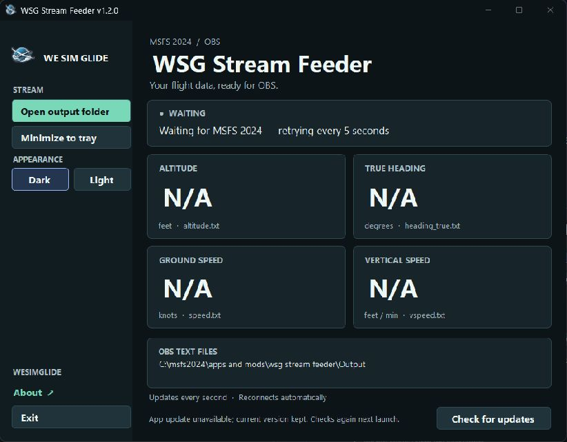

# WSG Stream Feeder

A small Windows x64 application that reads MSFS 2024 through Microsoft's SimConnect API and feeds selectable OBS text sources and a glider telemetry panel. No FSUIPC, flight plan, account, or OBS plugin is required. Aircraft reference lookup is optional; live telemetry works without network access.

**v1.3.0:** selectable glider telemetry, shared unit settings, aircraft reference gauges and a compact OBS capture window. When upgrading, repoint an old altitude text source from `altitude.txt` to `altitude_asl.txt`.

**v1.3.1:** the main window remembers its position, size and maximized state. The capture window separately remembers position and width; its height still follows the selected rows. Placement is saved after moving/resizing and on close in `%LOCALAPPDATA%\WSG Stream Feeder\main-window.json` and `capture-window.json`. Closing while minimized preserves the normal bounds. Windows return to a visible screen if a saved monitor is unavailable.

**v1.3.2:** the main window starts minimized if it was minimized at shutdown. The capture window automatically reopens if it was open at shutdown, restoring its position, width and minimized state. Closing the capture window yourself keeps it closed on the next launch. Opening it manually always restores it visibly. Height continues to fit the selected rows.

[Download the latest release](https://github.com/siglr/WSGStreamFeeder/releases/latest) · [WeSimGlide download page](https://wesimglide.org/otherdata/tools/WSG-Stream-Feeder.html) · [License](LICENSE.md)

**v1.3.3:** Settings includes **Start with the main window minimized**. Enable it and choose **Save settings** to start minimized even after restoring the main window to exit. Off by default, it replaces the main window's last-minimized-state behavior; position, size and maximized placement are still remembered. The capture window continues restoring its own open/closed and minimized state independently. The explicit `--minimized` launch option still takes precedence.



## License

Public, source-available software licensed under **PolyForm Noncommercial 1.0.0**, matching Standalone DLSS Glass Cockpit Refresh. You may use, modify, and share the original code for noncommercial purposes under its terms. Commercial use is not permitted. See [LICENSE.md](LICENSE.md) and [NOTICE.md](NOTICE.md). Microsoft components and supplied branding retain their separate terms.

## Run

Download and extract the complete release ZIP into a writable folder. Windows x64 and the .NET 8 Desktop Runtime (x64) are required.

Launch `WSG Stream Feeder.exe`. It automatically connects when MSFS is available, retries every five seconds, and requests telemetry once per second. Minimize it to the regular Windows taskbar and restore it from there. **Exit** or the window's close button stops the feeder and writes `N/A` to enabled files. Text files continue updating while minimized. For graphical capture, keep the separate capture window restored; OBS may freeze a minimized window.

The window uses WSG Client's colors and original app logo. Choose **Dark** or **Light** under **Appearance**; your selection is remembered in `%LOCALAPPDATA%\WSG Stream Feeder\theme.txt`. The **About** link opens [WeSimGlide.org](https://WeSimGlide.org/) in your default browser.

## Automatic updates

Official releases from v1.2.0 check for updates when opened. **Check for updates** runs another check. Downloads are verified against a product-specific RSA-3072 signature and SHA-256 file inventory before anything is replaced. An unavailable server leaves the feeder running normally.

If MSFS is connected, an update is staged and the button changes to **Restart to update**. Finish your stream before using it, or close and reopen the feeder later. If MSFS is disconnected, the verified update installs and reopens automatically. Your `settings.json`, output files, custom output path, minimized state, saved theme and telemetry preferences are preserved. The updater works in the feeder folder, never in the simulator installation.

Keep the complete release together, including `WSG Stream Feeder.Updater.exe`, its three companion files, and `app-files.json`. Updating modified release files is deliberately refused; extract a fresh official package if you have changed managed files. Recovery data in `.app-update` is retained after an interrupted update and processed on the next launch. Do not manually remove it during recovery. Details are in `PUBLISHING.md` and `SECURITY.md` in the source.

Output defaults to an `Output` subfolder beside the EXE. To customize it, copy the included `settings.example.json` to `settings.json` and change `OutputDirectory`. Development builds include `settings.json` directly.

In OBS, edit each of your four text sources, keep **Read from file** enabled, and browse to its matching file in the feeder's Output folder.

To use another output location, edit `OutputDirectory` in `settings.json` and update the four OBS text sources to that folder. Alternatively launch with `--output "C:\some\folder"`. Relative paths are resolved beside the EXE. Launch with `--minimized` to start minimized on the taskbar. A second feeder using the same output path is rejected.

## Telemetry settings and capture

In **Settings**, select **File**, **Panel**, or both for each channel. Move rows up/down to arrange the panel. Save to apply changes. Units are shared by the panel and text exports, with separate altitude, airspeed, vertical rate, wind, weight, temperature, pressure choices. **Units in text files** adds suffixes; it is off by default to preserve existing OBS text layouts. Settings are saved in `%LOCALAPPDATA%\WSG Stream Feeder\telemetry.json` and survive app updates. Restore defaults stages the defaults; Save settings applies them.

**Open capture window** moves the telemetry panel into a separate taskbar window that OBS can capture and crop; the main telemetry area stays blank until the capture window closes. This stays open when you minimize the settings window. Drag either side to widen the gauges; values stay aligned at the right. Height fits the selected rows automatically and cannot be resized manually. The panel size control scales text and graphics together. Compact labels include GRND, ASL, AGL, IAS and TAS. Selecting either wind channel displays a single WIND row with a rotating arrow and `90° @ 12 kt` format; the two wind text files remain independently selectable. Flap labels are centered in their cells. Dark/Light applies to both windows. Closing the main application closes its capture window and stops the feeder.

**Preview with sample data** is clearly marked and affects the graphical panel only. It never writes fictional readings to OBS files. It is not persisted across app restarts.

Available channels: geometric ASL altitude, AGL, native ground elevation, true heading, GPS ground track, ground speed, IAS, TAS, indicated vertical speed, horizontal wind speed, wind-from bearing, vertical air mass, current total weight, flap handle/label, MacCready, temperature, ambient pressure, gear handle and on-ground state, and simulation rate. Hover a channel name to see its meaning and filename. ASL altitude, heading, ground speed and vertical speed files are enabled by default. Disabled existing telemetry files are set to `N/A` (not deleted); new disabled files are not created. Unrelated filenames are untouched.

V/SPD uses MSFS's reported vertical speed directly, displayed on a centered nonlinear ±5 m/s gauge (green climb, red descent). It does not calculate altitude differences and is distinct from TE/netto and ambient vertical wind. TE/netto and individual ballast channels are not enabled in this release. Missing readings are `N/A`; a real zero remains zero. Non-paused telemetry older than five seconds is marked unavailable even if SimConnect still answers its heartbeat.

### Aircraft reference and gauges

The client calls `https://wesimglide.org/api/GetGliderReference.php` asynchronously after identifying the aircraft. It sends only aircraft type (folder identity, with simulator TITLE fallback), wingspan and competition class. No paths, config contents, positions, pilot identity, cookies or account credentials are sent. There is one successful lookup per aircraft/variant; no periodic lookup during normal flight. Requests have bounded response size and timeout. Reconnects can reuse a cached response within the server TTL. Failed lookups retry independently every five minutes; telemetry never waits for the server. Unknown responses count as successful lookups.

On aircraft/variant change, old limits are cleared immediately and late responses for the previous identity are ignored. Partial/unknown metadata retains live numbers and raw flap indices. Only available positive limits enable TAS/MTOW rails and warnings. Known unflapped aircraft are omitted from the graphical flap display. Catalog labels are one-based; the raw simulator index is converted exactly once at lookup. The flap ladder descends from highest position at left to lowest at right.

The AGL and vertical-speed rails use WSG's nonlinear scales. TAS is compared with the catalog **TAS** VNE; total weight is compared with MTOW. Equality is not a warning, and warning comparisons use unrounded physical values. Weight fills from 45% to 100% MTOW; that lower endpoint is only a visual scale, not an empty-weight measurement. The TAS filled bar turns red above VNE, with white text for contrast; the amber band begins at 90% of VNE. IAS uses the same visual range as TAS when known (otherwise 0–300 km/h), but its blue bar does not claim an IAS limit from a TAS reference. GS uses a blue 0–400 km/h display range, and MC a blue 0–5 m/s range. These are display ranges, not operating limits; overflow markers appear beyond the scale while the actual number remains visible. Units convert the readout without changing the physical scale. MC is the pilot's selected expected climb setting, not measured lift. HDG and TRK arrows sit beside their bearings and point toward the nose direction and direction of travel respectively, with north at the top. The wind bearing is **from** true north, while its arrow points downwind. Wingspan remains an internal aircraft/variant-identification input and is no longer offered as an overlay or text export; an existing preview `wingspan.txt` is retired to `N/A`.

ASL is geometric altitude above sea level. AGL uses the simulator's height above the surface, including obstacles. ELEV is the direct ground-elevation value. ALT, GRND and CLIMB have been removed. Saved file/panel selections migrate to ASL, ELEV and V/SPD respectively, preserving order and merging duplicates. ASL uses `altitude_asl.txt`, ELEV uses `ground_altitude.txt`, and V/SPD retains `vspeed.txt`. Repoint an old OBS altitude text source from `altitude.txt` to `altitude_asl.txt`. Existing retired `altitude.txt`, `ground_asl.txt` and `climb_geometric.txt` files are set to `N/A`; they are not deleted or created anew.

### Performance

One SimConnect numeric sample per second drives all channels. There is no per-gauge polling, browser runtime, continuous animation or per-frame timer. A panel redraws when its readings, status or appearance change. Only changed text replaces an existing output file. Aircraft metadata is requested outside the simulator callback's synchronous work and cached separately. Files and the capture window continue working independently of the Settings tab.

The live MSFS/OBS workload still needs validation. The repeatable formatting microbenchmark in the telemetry tests measures CPU formatting only, not simulator latency or OBS capture cost. Development previews are published to `build/preview`, keeping `dist` reserved for the latest stable signed package.

## File contract

| File | Simulator value | Example |
| --- | --- | --- |
| `altitude_asl.txt` | Geometric altitude above sea level, feet by default | `12,346` |
| `heading_true.txt` | True heading in degrees | `274°` |
| `speed.txt` | Ground speed in knots (not indicated airspeed) | `124` |
| `vspeed.txt` | Vertical speed in feet per minute | `▴ 1,235`, `▾ 1,235`, or `0` |

Files use UTF-8 without BOM and without a trailing newline. The four default channels retain whole-number rounding with midpoint ties to even; additional channels use appropriate decimal precision. Altitude and vertical speed use commas for thousands. Positive vertical speed has U+25B4 plus one space; negative has U+25BE plus one space and an unsigned magnitude. Heading is not zero-padded; a rounded north heading is normalized to `0°`. Files say `N/A` before telemetry and after disconnect or normal exit. Values remain unchanged between simulator samples, including a paused simulator that still responds to the connection heartbeat.

Only changed values are replaced. Completed temporary files are moved over the destination, preventing partial values; if OBS or another reader blocks replacement, the window shows an error and the next tick retries. No unrelated output files are deleted or modified. Diagnostic logs live at `%LOCALAPPDATA%\WSG Stream Feeder\feeder.log`, outside the OBS folder.

## Build and dependencies

Source is in `src`. On Windows, obtain the two SimConnect dependencies described in [lib/README.md](lib/README.md), then run `./build.ps1` with a .NET SDK supporting .NET 8. The published program needs the .NET 8 **Desktop Runtime (x64)**. The SDK is only needed for building.

Ordinary source builds disable network updates. Run `package-release.ps1 -SigningKey <protected-key-file>` to explicitly build an official signed package; see `PUBLISHING.md`. Never publish an ordinary development build as a release.

The original logo and icon in `assets` were copied from the installed WSG Client's `Web\assets` folder. They are embedded in the executable, so WSG Client does not need to be installed for them to appear. The theme palettes in `src\Appearance.cs` match WSG Client's `Web\styles.css`.

Keep `SimConnect.dll` and `Microsoft.FlightSimulator.SimConnect.dll` beside the EXE. These Microsoft binaries retain their original licensing. For a fresh checkout, obtain the corresponding x64 components from the Microsoft Flight Simulator SDK and place them in `lib`. Do not assume Microsoft binaries can be relicensed as this application's source.

`build.ps1` runs the executable compatibility and updater checks and publishes to `dist\WSG Stream Feeder`. Tests cover SimConnect field offsets, unit conversions, independent selection, formatting, exact bytes, file locks, retry, disconnected/missing readings, nonlinear rails and threshold equality, selection migration, settings persistence, bounded HTTP responses, cached/unknown aircraft metadata, and updater signature/rollback/process recovery. Run `dotnet run --project tests -c Release -- --live-reference-check` to additionally check the six production endpoint fixtures through the actual C# client; normal tests do not access the network. Updater fixtures use ephemeral test keys and temporary folders, never a real MSFS installation. To smoke-test the actual executable without changing OBS files:

```powershell
& ".\WSG Stream Feeder.exe" --output "C:\Temp\WSG Stream Feeder-smoke" --diagnostic-seconds 10 --minimized
```

That mode runs the normal application for ten seconds and exits; it never generates fictional flight telemetry. The log reports startup and simulator connection status. A live flight remains necessary to validate reception against MSFS on this PC.

Microsoft references: [SimConnect Open](https://docs.flightsimulator.com/msfs2024/retail/programming-apis/simconnect/api-reference/general/simconnect_open/), [System-state heartbeat](https://docs.flightsimulator.com/msfs2024/retail/programming-apis/simconnect/api-reference/general/simconnect_requestsystemstate/), [Aircraft SimVars](https://docs.flightsimulator.com/msfs2024/html/6_Programming_APIs/SimVars/Aircraft_SimVars/Aircraft_Misc_Variables.htm).
